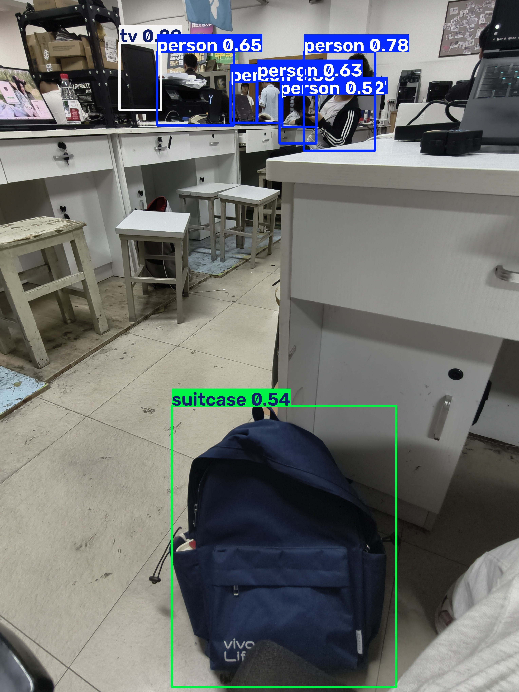

# Assignment 3 - YOLO

## 1. 任务说明

我选择检测的目标是 **COCO 80 类通用目标**（人、车、家具、日用品等）。
训练用官方小数据集 coco128；推理演示图是自己在实验室拍的实拍照
（`/home/szc/下载/IMG_20261013_193728.jpg`），框出了远处工位上的人、
地上的背包和桌上的显示器。

## 2. 数据集

- 数据集名称：**coco128**（COCO train2017 的前 128 张图）
- 数据集来源：Ultralytics 官方发布，
  `https://github.com/ultralytics/assets/releases/download/v0.0.0/coco128.zip`
  （原始出处 https://www.kaggle.com/datasets/ultralytics/coco128）
- 包含类别：**80 类**（person、bicycle、car … teddy bear、toothbrush）
- 结构（YOLO 格式）：

```
coco128/
├── images/train2017/   128 张 jpg
├── labels/train2017/   128 个 txt，每行: 类别 id + 归一化的 cx cy w h
└── (data.yaml 由 ultralytics 内置的 coco128.yaml 提供)
```

- `train` / `val`：coco128 官方设置里 train 和 val 是**同一批 128 张图**
  （它本身就是用来跑通流程的调试集），所以验证指标和训练集同分布，
  看趋势可以，不代表泛化能力。

## 3. 模型训练

- 使用的 YOLO 版本：**YOLO11**（ultralytics 8.4.175）
- 使用的预训练模型：**yolo11n.pt**（官方 COCO 预训练权重，nano 档）
- 训练命令（CLI 等价写法）：

```bash
yolo detect train model=yolo11n.pt data=coco128.yaml epochs=30 imgsz=640 device=0
```

实际运行的是等价脚本：

```bash
conda activate yolo
python src/train.py
```

- 主要训练参数：epochs=30，imgsz=640，batch=16（默认），device=0，
  其余为 ultralytics 默认值（SGD、mosaic 增强等，见 `runs/train/args.yaml`）
- 环境：conda 环境 `yolo`（Python 3.12.15、torch 2.14.1+cu130），
  GPU 为 NVIDIA GeForce RTX 5070 Ti Laptop，30 epoch 耗时 10 分 33 秒
- 验证集指标（128 张）：

| | precision | recall | mAP50 | mAP50-95 |
|---|---|---|---|---|
| best.pt（epoch 21，按 mAP50-95 选出） | 0.788 | 0.750 | 0.805 | 0.631 |
| 最后一个 epoch（30） | 0.843 | 0.712 | 0.804 | 0.625 |

逐 epoch 曲线见 `runs/train/results.csv`（该目录已 gitignore，本地可复现）。

## 4. 模型测试

测试使用的命令（CLI 等价写法）：

```bash
yolo detect predict model=runs/train/weights/best.pt source=<图片>
```

实际运行：

```bash
python src/predict.py /home/szc/下载/IMG_20261013_193728.jpg
```

检出 8 个框（conf 阈值 0.25）：

| 类别 | 置信度 | x1, y1, x2, y2 |
|---|---|---|
| person | 0.785 | 1791, 306, 2210, 889 |
| person | 0.651 | 925, 305, 1379, 740 |
| person | 0.628 | 1517, 454, 1656, 724 |
| person | 0.546 | 1358, 482, 1513, 724 |
| suitcase | 0.537 | 1014, 2394, 2336, 4052 |
| person | 0.517 | 1649, 558, 1865, 846 |
| person | 0.473 | 1665, 556, 1866, 748 |
| tv | 0.289 | 705, 251, 950, 650 |

检测结果图：



说明：照片摄于实验室。6 个 person 框都落在远处工位上的人身上，
置信度高的框到人更完整，0.5 上下的两个是被桌子挡住的下半身；
`suitcase 0.54` 是前景地上的蓝色双肩包——框的位置对，但类别在
backpack / suitcase 之间判错了，属于诚实的错检，不修；
`tv 0.29` 是左边架子上的显示器，COCO 里显示器和电视同类，算检对。

值得一提的失败案例：同一个背包先拍过一张贴近占满画面的特写，
推理结果 0 个框（把阈值降到 0.01 看，最高分也只有 suitcase 0.20、
backpack 0.04）——目标占满全图、没有背景上下文时模型完全不认。
换成这张带环境的远景后就正常了。

## 5. 对 YOLO 的理解

1. **YOLO 是用来做什么的？**
   目标检测：输入一张图，一次性输出"图里有哪些物体、各自在哪"。
   名字是 You Only Look Once——整张图只过一遍网络就同时给出所有框，
   不像两阶段方法先提候选区域再分类，所以快，能跑实时。

2. **什么是 Bounding Box？**
   框住一个目标的矩形。训练标签里存的是归一化的
   `中心x, 中心y, 宽, 高`（相对图宽图高，0~1）；输出给人看时换算成
   像素坐标的 `x1, y1, x2, y2`，就是上表和结果图上的框。

3. **什么是 Confidence？**
   模型对"这个框里确实是这个类"的把握，0~1。
   推理时用阈值（本次 0.25）把低置信度的框滤掉；
   阈值调高框变少但更准，调低框变多但误检也多。

4. **Training 和 Predict 有什么区别？**
   Training 是拿带标签的图反复调整网络权重（跑 epoch、算 loss、反向传播），
   产物是 `.pt` 权重文件；Predict 是冻结权重、只前向传播，
   对新图出框，不改动模型。一个学、一个用。

5. **训练得到的 .pt 文件是什么？**
   一个 checkpoint：网络结构 + 学到的全部权重 + 训练元信息
   （类别名、epoch、指标等）。`best.pt` 是验证指标最好的那一轮，
   `last.pt` 是最后一轮。加载它就能直接 predict，或接着 train。

## 6. 复现备注

- 装环境：`conda create -n yolo python=3.12 && pip install ultralytics`
  （torch 随 ultralytics 一起装，本机 wheel 自带 cu130）
- 本机直连 github 不稳定，权重和数据集是用 curl 断点续传拉下来后再跑的；
  ultralytics 的数据集目录已用 `yolo settings datasets_dir=/home/szc/datasets`
  固定，避免它默认落到仓库目录里
- `runs/`（训练产物、权重）和 `yolo11n.pt`（官方预训练权重）不进 git，
  复跑会自动重新生成/下载
